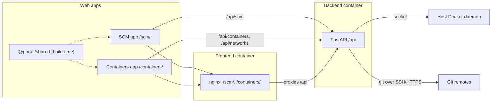

# Docker Management Portal: Implementation Plan

A self-hosted portal for a remote server, made of one backend and two separate web apps:
- **SCM app** (`/scm/`): register Git repos and deploy a chosen branch. A deploy runs fetch, checkout, `docker compose build` and `docker compose up -d`, with live output and the commit hash recorded.
- **Containers app** (`/containers/`): manage containers and Docker networks, and view live logs.
- **Backend:** a FastAPI service that runs as a container on the server and controls the host's Docker daemon through the mounted socket.

Each web app is built, run and deployed on its own and works as a page by itself.

## Tech design documents
- [Backend tech design](docs/tech-design-backend.md): FastAPI service, API contract, data model, deploy pipeline, static hosting of both apps, and deployment.
- [Frontend tech design](docs/tech-design-frontend.md): the two Vite apps and their shared package, pages, which endpoints each screen calls, streaming, configuration and builds.

The API contract lives in the backend document and is the interface all three parts build against.

## Shared decisions
- **Backend:** Python 3.12, FastAPI, SQLModel on SQLite, the Docker SDK plus the Docker CLI with the compose plugin.
- **Frontend:**
  - Two Vite + React + TypeScript apps in one npm workspace, sharing a source-only `@portal/shared` package (API client, types, SSE hook, UI components and theme).
  - No host shell and no microfrontend runtime.
  - The supplied prototype is a visual and behavioral reference only.
- **Build:** two images, one Dockerfile per top-level folder. `backend/Dockerfile` builds the API; `frontend/Dockerfile` builds both web apps into a single nginx image.
- **Hosting:** nginx serves both apps from one origin and proxies `/api` to the backend, so `CORS_ORIGINS` stays off by default. The backend is a pure API service and publishes no host port; only nginx binds `127.0.0.1:8000`. Either app can be hosted elsewhere by setting `VITE_API_BASE_URL` and the backend's `CORS_ORIGINS`.
- **Deploy model:** Docker Compose. Only the latest build is kept, and each deployment records its branch and commit hash.
- **Runtime:** two containers on the host, sharing the host's `/var/run/docker.sock`. Docker-in-Docker is not used.
- **Auth:** none in v1. The portal is bound to `127.0.0.1`.

## Architecture

## Implementation checklist

**Backend**
- [x] Scaffold: FastAPI, settings, SQLModel/SQLite, error envelope, `/api/health`, static hosting for `/scm/` and `/containers/` with per-app SPA fallback
- [x] SCM repos API: list/create (validated with `git ls-remote`)/get/patch/delete, branches, optional commits
- [x] Job runner: background deployments, sequence-numbered log buffer, step events, SSE replay from offset, cancel
- [x] Deploy pipeline: clone-or-fetch, checkout, compose build, compose up -d, re-apply network attachments; stack actions
- [x] Containers API: list with filters, stop/start/restart, logs SSE with stdout/stderr tagging, log download
- [x] Networks API: list, create, delete with guards, batch connect/disconnect with saved attachments
- [x] Tests: unit tests, plus Docker-marked integration tests

**Frontend: workspace and shared package**
- [x] npm workspace (`apps/*`, `packages/*`), base tsconfig, ESLint with a rule blocking imports between apps
- [x] `@portal/shared`: config, API client + `ApiError`, contract types, `useEventSource`, format helpers, UI components, `AppHeader` + `HealthBadge`, Tailwind theme

**Frontend: SCM app**
- [x] Scaffold (Vite react-ts, base `/scm/`, port 5173, `/api` proxy, router, QueryClient)
- [x] Repo list and Add Repository modal; repo detail with branch select, deploy, live output with resume, commit hash, history, link to the Containers app

**Frontend: Containers app**
- [x] Scaffold (Vite react-ts, base `/containers/`, port 5174, `/api` proxy, router, QueryClient)
- [x] Networks sidebar and modals, container cards with actions, `repoId` filter, live log panel

**Frontend: tests**
- [x] Type check, ESLint, Vitest for the shared package and key modals; build and serve each app on its own

**Delivery**
- [x] `backend/Dockerfile` (Python runtime plus the Docker CLI and compose plugin), `frontend/Dockerfile` (node build stage into nginx), `nginx.conf`, `docker-compose.yml` wiring both services, README
- [ ] Manual end-to-end check covering every SCM and Containers interaction from the sample, with each app opened on its own (needs the frontend apps)

## Out of scope for v1
- Argos Logs and TCC Configs (pages and backends).
- A host shell or any microfrontend runtime.
- Container metrics.
- Auth.
- Keeping old image versions, registry push, webhooks, multiple hosts.
