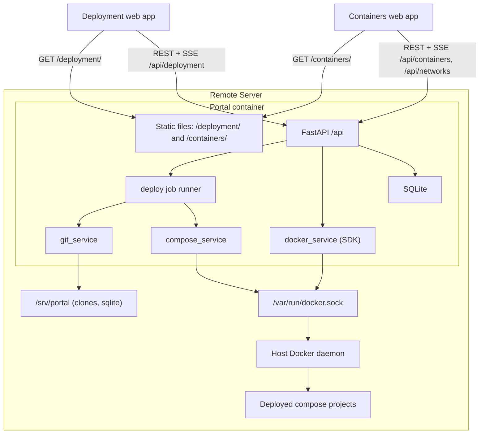
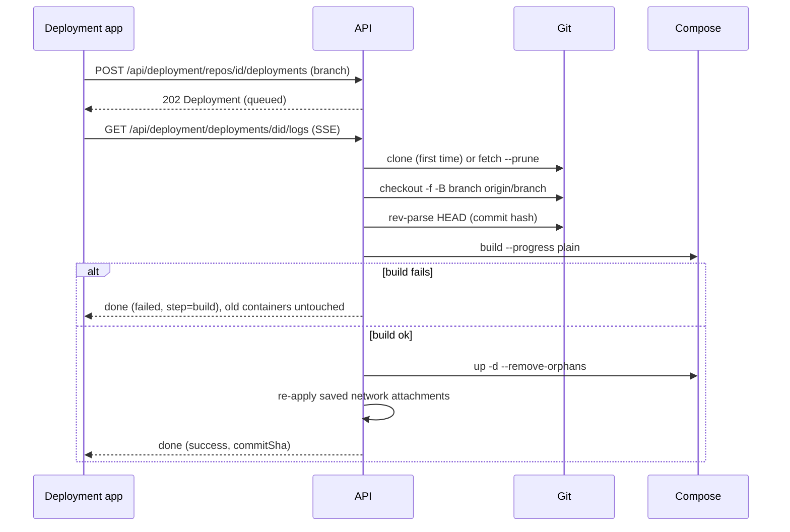

# Docker Management Portal: Backend Tech Design

This is the FastAPI service behind the portal's Deployment and Containers pages. It runs as a container on the remote server and controls the host's Docker daemon through the mounted socket. This document owns the **API contract** that the frontend builds against. The frontend design is in [tech-design-frontend.md](tech-design-frontend.md).

## Scope
- **Deployment:**
  - Register repos (name, Git URL, path) and list their branches.
  - Deploy a branch: fetch, checkout, `docker compose build`, then `docker compose up -d`. Stream the output and record the commit hash.
- **Containers:**
  - List containers and stop, start or restart them. Stream their logs.
- **Networks:**
  - List, create and delete networks. Connect containers to networks and disconnect them.
- **Static hosting:** serve the production builds of the two frontend apps (Deployment and Containers), each under its own path.
- **Out of scope:** Argos Logs and TCC Configs backends, container metrics, auth, keeping old image versions, registry push, webhooks, multiple hosts.

## Decisions
- **Repo config:** `name`, `url` and `path`. The path is relative to the repo root (`/` means the root) and holds `docker-compose.yml`. The compose file name is optional.
- **Deploy pipeline:** clone (first time) or fetch, then checkout, `docker compose build`, `docker compose up -d`, and re-applying network attachments. Only the latest build is kept, and each deployment records its branch and commit hash.
- **Docker access:**
  - The Docker CLI with the compose plugin, run through `subprocess`, for build, up, down, stop and restart.
  - The Python SDK (`docker` 7.x) for containers, logs and networks.
  - Both use the host daemon through the mounted `/var/run/docker.sock`. Docker-in-Docker is not used.
- **Stack:** Python 3.12, FastAPI, SQLModel on SQLite, SSE through `sse-starlette`, pydantic-settings, and a single uvicorn worker (job state lives in memory).
- **Auth:** none in v1. The port is bound to `127.0.0.1`, and all routes sit on one `/api` router so sign-in can be added later in one place.

## Architecture



## Deploy flow



## API contract

### Conventions
- All paths sit under `/api`, with JSON bodies and ISO-8601 UTC timestamps. JSON fields are camelCase.
- Container IDs are accepted as the short (12-character) or full form. Responses include both.
- Errors use one shape, `{ "error": { "code": "DEPLOY_IN_PROGRESS", "message": "...", "detail": {} } }`, with HTTP 400 (validation), 403 (protected resource), 404, 409 (conflict or wrong state) or 502 (Docker or Git failure).
- Streams use Server-Sent Events (SSE). Each stream sends a `: ping` comment every 15 seconds and stops reading from Docker when the client disconnects.

### Data types

```ts
type Repo = {
  id: string; name: string; url: string;
  path: string;                 // relative to repo root, "/" = root
  composeFile: string;          // default "docker-compose.yml"
  defaultBranch: string | null;
  cloned: boolean;
  lastDeployment: Deployment | null;
  createdAt: string;
};
type Branch = { name: string; commit: string };
type Commit = { sha: string; subject: string; author: string; committedAt: string };
type DeployStep = "clone" | "fetch" | "checkout" | "build" | "up" | "networks";
type Deployment = {
  id: string; repoId: string; branch: string;
  commitSha: string | null; commitMessage: string | null;
  status: "queued" | "running" | "success" | "failed" | "cancelled";
  step: DeployStep | null; error: string | null;
  startedAt: string; finishedAt: string | null;
};
type Container = {
  id: string; fullId: string; name: string; image: string;
  state: "running" | "exited" | "paused" | "restarting" | "created" | "dead";
  status: string;               // Docker text, e.g. "Exited (137) 4 hours ago"
  exitCode: number | null;
  ports: { containerPort: number; hostPort: number | null; hostIp: string | null; protocol: "tcp" | "udp" }[];
  networks: string[];
  createdAt: string; startedAt: string | null; finishedAt: string | null;
  repoId: string | null; service: string | null;   // set when deployed by the portal
};
type Network = {
  id: string; name: string; driver: string; scope: "local" | "swarm" | "global";
  subnet: string | null; internal: boolean;
  builtin: boolean;             // bridge, host, none
  composeManaged: boolean;      // a compose project's own network
  containerCount: number;
};
type LogLine = { time: string; stream: "stdout" | "stderr"; msg: string };
```

### Error codes
- `INVALID_PATH`, `INVALID_NAME`: 400. The request failed validation; `detail.field` names the field.
- `REPO_UNREACHABLE`: 400. Git couldn't reach the repo; `detail.stderr` holds Git's error output.
- `NAME_TAKEN`: 409. A repo or network with that name already exists.
- `NOT_CLONED`: 409. The repo hasn't been cloned yet.
- `DEPLOY_IN_PROGRESS`: 409. A deploy is already running; `detail.deploymentId` identifies it.
- `PROTECTED`: 403. The target is the portal's own container, or a built-in or compose-owned network.
- `NOT_FOUND`: 404.
- `DOCKER_ERROR`, `GIT_ERROR`: 502. Docker or Git failed; `detail.stderr` holds the error output when there is one.

### System
- `GET /api/health` returns `{ status: "ok" | "degraded", docker: { reachable, serverVersion }, git: { version } }`.

### Deployment: repositories
- `GET /api/deployment/repos` returns `Repo[]`.
- `POST /api/deployment/repos` with `{ name, url, path?, composeFile? }` returns `201 Repo`.
  - It runs `git ls-remote --symref <url>` with a 20-second timeout to check access and find the default branch. Nothing is cloned until the first deploy.
  - Errors: `INVALID_NAME`, `INVALID_PATH`, `REPO_UNREACHABLE`, `NAME_TAKEN`.
- `GET /api/deployment/repos/{repoId}` returns `Repo`.
- `PATCH /api/deployment/repos/{repoId}` with `{ name?, path?, composeFile? }` returns `Repo`. The URL can't be changed.
- `DELETE /api/deployment/repos/{repoId}?teardown=true` returns 204. It runs `compose down` when `teardown` is set, then deletes the clone and the repo's records.
- `GET /api/deployment/repos/{repoId}/branches` returns `{ defaultBranch, branches: Branch[] }`. It reads `git ls-remote --heads`, so it works before the first clone.
- `GET /api/deployment/repos/{repoId}/commits?branch=develop&limit=20` returns `Commit[]`. Optional. Returns `NOT_CLONED` before the first deploy.

### Deployment: deployments
- `POST /api/deployment/repos/{repoId}/deployments` with `{ branch, commit? }` returns `202 Deployment`.
  - Returns `DEPLOY_IN_PROGRESS` if a deploy is already running for this repo.
- `GET /api/deployment/repos/{repoId}/deployments?limit=20` returns `Deployment[]`, newest first.
- `GET /api/deployment/deployments/{deploymentId}` returns `Deployment & { containers: Container[] }`.
- `GET /api/deployment/deployments/{deploymentId}/logs?offset=0` is an SSE stream. Events:
  - `step`: `{ step, status: "started" | "succeeded" | "failed" }`
  - `line`: `{ seq, text }`. Each command is sent as a `$ <command>` line before its output.
  - `done`: `{ status, commitSha, commitMessage, error }`, after which the stream closes.
  - The stream replays every line from `offset` onward. A finished deployment replays its saved log, then sends `done`.
- `POST /api/deployment/deployments/{deploymentId}/cancel` returns `Deployment`. Optional. It kills the running command. If cancelled before `up`, the previous containers keep running.

### Deployment: stack actions
- `POST /api/deployment/repos/{repoId}/stack/{action}`, where `action` is `up`, `stop`, `restart` or `down`, returns `{ containers: Container[] }`.
  - `up` runs `compose up -d` with no rebuild and then re-applies network attachments.

### Containers
- `GET /api/containers?all=true&network=&repoId=&q=` returns `Container[]`.
  - `all=true` includes stopped containers. `network` filters by network name. `q` matches name, ID or image.
  - The portal's own container (labelled `portal.self`) is always excluded.
- `POST /api/containers/{id}/stop` with `{ timeout?: 10 }` returns `Container`. Returns `PROTECTED` for the portal's own container.
- `POST /api/containers/{id}/start` and `POST /api/containers/{id}/restart` return `Container`.
- `GET /api/containers/{id}/logs?tail=200&since=` is an SSE stream.
  - It sends recent `log` events (`LogLine`), then follows live ones.
  - It sends an `end` event when the container stops.
- `GET /api/containers/{id}/logs/download?tail=all` returns `text/plain`. Optional.

### Networks
- `GET /api/networks` returns `Network[]`.
- `POST /api/networks` with `{ name, driver?: "bridge", internal?: false }` returns `201 Network`. Returns `NAME_TAKEN` if the name exists.
- `DELETE /api/networks/{id}` returns 204.
  - It disconnects attached containers first and removes any saved attachments.
  - Returns `PROTECTED` for built-in networks and for networks that belong to a compose project.
- `POST /api/networks/{id}/connect` with `{ containerIds: string[], aliases?: string[] }` returns `{ connected: string[], failed: { containerId, error }[] }`.
  - For containers the portal deployed, it also saves a `NetworkAttachment` so the connection is restored after a redeploy.
- `POST /api/networks/{id}/disconnect` with `{ containerIds: string[] }` returns the same shape. It also deletes any saved attachment.

## Data model (SQLite)
- `Repo`: `id`, `name`, `slug` (unique, also the compose project name), `url`, `path`, `compose_file`, `default_branch`, `created_at`
- `Deployment`: `id`, `repo_id`, `branch`, `requested_commit`, `commit_sha`, `commit_message`, `status`, `step`, `error`, `log` (JSON lines with sequence numbers), `started_at`, `finished_at`
- `NetworkAttachment`: `id`, `repo_id`, `service`, `network`, `aliases`

Containers and networks themselves aren't stored. They're read live from Docker. Containers deployed by the portal are matched through compose labels: `com.docker.compose.project=<slug>` gives the repo, and `com.docker.compose.service` gives the service.

## Code layout

```
backend/
  app/
    main.py              # app factory, /api router, static mounts for both apps + SPA fallback, startup tasks
    config.py            # WORKSPACE_DIR, DB_URL, CORS_ORIGINS, DEPLOYMENT_DIST_DIR, CONTAINERS_DIST_DIR, timeouts
    db.py  models.py     # SQLModel engine + tables
    schemas.py           # request/response models (camelCase aliases)
    errors.py            # ApiError + exception handlers -> error envelope
    services/
      git_service.py     # ls-remote, clone, fetch, checkout, rev-parse, log
      compose_service.py # argv builder + streaming runner
      docker_service.py  # containers, logs, networks
      jobs.py            # deployment runner, seq log buffer, SSE fan-out, cancel
    routers/
      health.py  deployment.py  containers.py  networks.py
  tests/
  pyproject.toml         # fastapi, uvicorn[standard], sqlmodel, docker, sse-starlette, pydantic-settings; dev: pytest, httpx
```

### Static hosting of the two web apps
- `/deployment/*` serves the Deployment app's `dist` (`DEPLOYMENT_DIST_DIR`). `/containers/*` serves the Containers app's `dist` (`CONTAINERS_DIST_DIR`).
- Within each base path, a request that doesn't match a file returns that app's own `index.html`. This makes client-side deep links such as `/deployment/123` work.
- `/` redirects to `/deployment/`.
- If an app's directory is missing, its path returns 404 and the rest of the service keeps working. Either app can therefore be deployed elsewhere and left out of this image.
- Hashed assets (`/assets/*`) get `Cache-Control: public, max-age=31536000, immutable`. Each `index.html` gets `no-cache`.

## Key implementation notes
- **Git:**
  - Commands are passed as argument lists, never through a shell.
  - `GIT_TERMINAL_PROMPT=0` and `GIT_SSH_COMMAND="ssh -o BatchMode=yes"` make missing credentials fail immediately.
  - Branch checkout uses `checkout -f -B <b> origin/<b>`. A specific commit uses `checkout -f --detach <sha>`.
- **Compose:**
  - Commands take the form `docker compose -p <slug> -f <clone>/<path>/<composeFile> --project-directory <clone>/<path>`.
  - `GIT_COMMIT` and `GIT_BRANCH` are set in the environment.
  - If the compose file is missing, the deploy fails at the `checkout` step with a clear error.
- **Path safety:** slugs are limited to `[a-z0-9-]`. `path` is normalized (leading `/` stripped) and must resolve inside the clone.
- **Concurrency:** each repo gets an `asyncio.Lock` for deploys and stack actions. Different repos can deploy in parallel. Blocking SDK and subprocess calls run in threads.
- **Logs (stdout and stderr):** the SDK's follow stream merges stdout and stderr. To tell them apart, the backend runs two followers (`stdout=True, stderr=False` and the reverse) with timestamps on. Each line is tagged and both feed one queue. Containers running with a TTY report everything as stdout.
- **Deployments:** each log line gets a sequence number, held in an in-memory ring buffer (10k lines) and saved when the deploy finishes. On startup, deployments still marked running are set to failed.
- **Networks:** saved attachments are re-applied after each `up`. "Already connected" errors are ignored.
- **CORS:** off by default. Both apps' dev servers proxy `/api`, and in production both are served from the same origin as the API. It's enabled only when `CORS_ORIGINS` is set, for example when an app is hosted on a different origin.

## Deployment

```yaml
services:
  portal:
    build: .
    ports:
      - "127.0.0.1:8000:8000"
    volumes:
      - /var/run/docker.sock:/var/run/docker.sock
      - /srv/portal:/srv/portal
      - ~/.ssh:/root/.ssh:ro
    environment:
      WORKSPACE_DIR: /srv/portal/repos
      DB_URL: sqlite:////srv/portal/portal.db
    labels:
      portal.self: "true"
    restart: unless-stopped
```

- The image is built in stages:
  - Stage 1 (`node:lts-slim`) runs `npm ci` and `npm run build` in `frontend/`, producing `apps/deployment/dist` and `apps/containers/dist`.
  - Stage 2 (`python:3.12-slim`) adds `git` and `openssh-client`, plus the Docker CLI and compose plugin copied from `docker:cli`. It installs the backend and copies both `dist` folders to `/app/web/deployment` and `/app/web/containers`.
- The workspace is mounted at the same path inside and outside the container, so relative bind mounts in compose files resolve correctly on the host.
- The process runs as root for socket access, or as a non-root user with `group_add` set to the host's docker group ID.
- The README covers Git credentials and `known_hosts`, the same-path mount requirement, and the warning that Docker socket access equals root on the host while there's no auth.

## Verification
- **Unit tests:**
  - Git and compose command builders, using a temporary bare repo for `ls-remote`, clone, fetch and checkout.
  - Path and slug validation.
  - The error envelope and error codes.
  - Static hosting: deep-link fallback for each app, the `/` redirect, and a 404 when an app's directory is missing.
  - The SSE replay offset logic.
- **Integration tests** (marked `docker`, run only when a Docker daemon is available):
  - Deploy a two-service compose fixture and check the commit hash and containers.
  - Deploy a broken commit and check the previous containers are still running.
  - Connect a container to a network, redeploy, and check the attachment came back.
  - Read logs and check stdout and stderr are tagged correctly.
  - Stop and start a container. Delete a network, and confirm built-in networks are refused.
